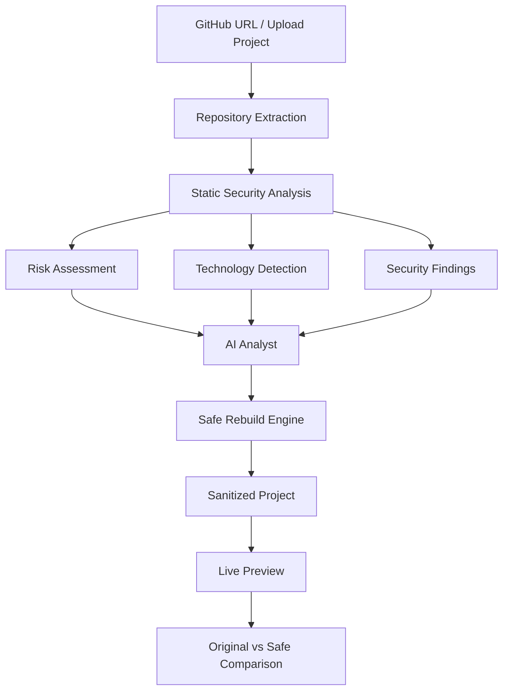

<div align="center">


<br/>


<br/><br/>

**SCAN. ANALYZE. UNDERSTAND. REBUILD. SECURE.**

<br/>

[](https://github.com/YOUR_USERNAME/RepoLens/stargazers)
[](https://github.com/YOUR_USERNAME/RepoLens/forks)


<br/>

### 🖤 EVERY REPOSITORY HAS A STORY. DISCOVER WHAT'S HIDDEN.

</div>

---

# 🧠 What is RepoLens?

**RepoLens** is an AI-powered repository intelligence, security analysis, and safe reconstruction platform.

It helps developers understand what actually happens inside a codebase.

Simply paste a GitHub repository URL or upload a project archive. RepoLens analyzes the source code, identifies suspicious patterns, detects potentially exposed credentials, explains security risks, identifies the technology stack, and builds a live preview of the application.

But RepoLens goes beyond traditional security scanners.

Its **Safe Rebuild Engine** aims to reconstruct suspicious projects into safer versions by neutralizing detected threats while preserving legitimate application functionality wherever possible.

<div align="center">

```text
   REPOSITORY IN
        |
        v
   SECURITY SCAN
        |
        v
   AI ANALYSIS
        |
        v
   RISK DETECTION
        |
        v
   SAFE REBUILD
        |
        v
   LIVE COMPARISON
        |
        v
   SECURE PROJECT
```

</div>

---

# ⚡ Why RepoLens?

Traditional scanners tell you that something is wrong.

RepoLens aims to explain:

- What does the suspicious code actually do?
- Why is it dangerous?
- Which files are affected?
- What could happen if the code executes?
- How can the issue be fixed?
- Can the project still work after remediation?
- What changed between the original and safe versions?

**The goal is to turn repository security into an understandable and actionable experience.**

---

# ✨ Core Features

## 🔍 01. Intelligent Repository Scanner

Scan projects directly from GitHub or upload supported files.

- GitHub repository URL scanning.
- ZIP archive uploads.
- TAR.GZ archive uploads.
- Individual HTML file uploads.
- Automatic project extraction.
- Repository structure analysis.
- Source-code inspection.

## 🛡️ 02. Advanced Security Detection

Identify potentially dangerous code patterns.

Detection categories include:

| Detection | Description |
|---|---|
| Hardcoded Secrets | Exposed API keys and credentials |
| AWS Credentials | Potentially leaked AWS access keys |
| Dynamic Execution | Suspicious `eval()` usage |
| Obfuscation | Encoded and suspicious payloads |
| Keyloggers | Suspicious keyboard monitoring |
| Data Exfiltration | Suspicious webhook communication |
| Clipboard Abuse | Unauthorized clipboard access patterns |
| Network Abuse | Suspicious external requests |
| Fake Packages | Potential dependency impersonation |
| Crypto Mining | Potential mining-related behavior |

## 🤖 03. AI Security Analyst

Understand suspicious code through AI-generated explanations.

Every finding can provide:

- What the code does.
- Why it is suspicious.
- Potential security consequences.
- Affected file and line.
- Recommended remediation.
- Technical explanation in understandable language.

## 📊 04. Risk Assessment Dashboard

Every scan receives an overall risk score.

| Score | Risk Level |
|---|---|
| 0–20 | 🟢 LOW |
| 21–40 | 🟡 MODERATE |
| 41–60 | 🟠 ELEVATED |
| 61–80 | 🔴 HIGH |
| 81–100 | ☠️ CRITICAL |

Risk scores are heuristic assessments, not guarantees of maliciousness.

## 🧬 05. Technology Stack Detection

Automatically identify technologies used inside repositories.

- Programming languages.
- Frontend frameworks.
- Backend technologies.
- Package managers.
- Build tools.
- Project dependencies.

## 🌐 06. Live Project Preview

RepoLens can build and display supported projects in an interactive preview.

Features include:

- HTML/CSS/JavaScript rendering.
- Supported npm/Vite project builds.
- Interactive application preview.
- Desktop and mobile viewport modes.
- Reload functionality.
- Build logs.
- Sandboxed iframe execution.

## 🛠️ 07. Safe Rebuild Engine

**The heart of RepoLens.**

Create a sanitized reconstruction of a scanned project.

The current implementation includes sanitization mechanisms for detected patterns such as:

- Dynamic execution patterns.
- Suspicious keyboard monitoring.
- Suspicious external endpoints.
- Hardcoded credentials and secrets.
- Remote script loading.
- Risky installation lifecycle scripts.

The Safe Rebuild Engine generates a separate reconstructed project rather than silently modifying the original source.

## ⚖️ 08. Original vs Safe Comparison

Compare the original application against the sanitized version.

| Original | Safe Rebuild |
|---|---|
| Original source | Sanitized source |
| Detected suspicious patterns | Applied mitigations |
| Original live preview | Safe live preview |
| Original functionality | Preserved functionality where possible |
| Security findings | Sanitization report |

---

# 🖥️ Platform Workflow

<div align="center">

### HOW REPOLENS WORKS

</div>



---

# 🛡️ Safe Rebuild Architecture

The reconstruction workflow is designed around the following principles:

1. Preserve the original repository.
2. Create an isolated working copy.
3. Identify detected suspicious patterns.
4. Apply appropriate sanitization transformations.
5. Record every modification.
6. Rebuild the sanitized project.
7. Verify whether legitimate functionality remains operational.
8. Display the sanitized result alongside the original.

**Important:** Automated sanitization cannot guarantee complete malware removal. Every reconstruction should be treated as a proposed remediation requiring validation.

---

# ⚙️ Technology Stack

| Technology | Purpose |
|---|---|
| Next.js 16 | Full-stack application |
| React | Frontend interface |
| TypeScript | Type safety |
| Tailwind CSS | UI styling |
| shadcn/ui | UI components |
| Prisma | Database ORM |
| Node.js | Backend processing |
| AI SDK | AI-powered explanations |
| Sandboxed iframe | Live project preview |

*Verify the final dependency manifest and configuration before publishing this list as definitive.*

---

# 🚀 Installation

## Prerequisites

- Node.js
- npm
- Git
- Database configuration
- Required AI credentials

### 1. Clone Repository

```bash
git clone https://github.com/YOUR_USERNAME/RepoLens.git
```

### 2. Enter Project Directory

```bash
cd RepoLens
```

### 3. Install Dependencies

```bash
npm install
```

### 4. Configure Environment Variables

Create a `.env` file.

```env
DATABASE_URL="your_database_url"

# Configure the required AI credentials
# Add other environment variables required by the application
```

Never commit real credentials or `.env` files.

### 5. Run Database Setup

Use the database setup command configured in your project.

### 6. Start Development Server

```bash
npm run dev
```

### 7. Open Application

```text
http://localhost:3000
```

---

# 🔐 Security Philosophy

RepoLens follows a security-first approach.

- Scanned source code is not executed during static analysis.
- Archive extraction includes path-traversal protections.
- Preview applications use sandboxed iframes.
- Supported dependency installations disable lifecycle scripts.
- Detected secrets should be redacted in displayed reports.
- Sanitized builds are separated from original source files.

**Security disclaimer:** Static analysis can produce false positives and false negatives. Sandboxing reduces risk but does not eliminate every attack surface. Never treat a RepoLens scan or Safe Rebuild result as a certification that a project is completely safe.

---

# 🗺️ THE MASTER ROADMAP

<div align="center">


</div>

> The following features represent the proposed development roadmap. They are not claims that all 110 features are currently implemented.

## 🛡️ A. Safe Rebuild & Remediation Engine

- [ ] **1. Safe Rebuild v2** — Stub exfiltration endpoints, neutralize eval chains, redact real secrets, and rebuild a clean copy.
- [ ] **2. Safe-vs-Original Diff Viewer** — Side-by-side comparison with removed lines highlighted.
- [ ] **3. AI Patch Suggestions** — Generate exact replacement code and apply patches individually.
- [ ] **4. Download Sanitized Project** — Export reconstructed projects as ZIP files.
- [ ] **5. Auto-PR** — Open pull requests with fixes on a GitHub fork.
- [ ] **6. Explain This Fix** — Explain every applied patch.
- [ ] **7. Fix-Confidence Meter** — Classify fixes as auto-safe or requiring human review.
- [ ] **8. Fix History & Rollback** — Maintain fix history and restore earlier versions.

## 🔍 B. Deeper Scanning Engine

- [ ] **9. AST-Based JS/TS Analysis** — Babel AST analysis instead of regex-only detection.
- [ ] **10. Deobfuscation Sandbox** — Safely inspect eval/Base64 chains without executing untrusted payloads on the host.
- [ ] **11. Dynamic Analysis** — Run applications in isolated environments and record actual behavior.
- [ ] **12. Network Egress Log** — Record outbound requests and destinations.
- [ ] **13. DOM/Keyboard/Clipboard Monitor** — Detect suspicious browser interactions.
- [ ] **14. Crypto-Miner Signatures** — Detect Coinhive-style and WASM mining patterns.
- [ ] **15. Web3 Drainer Detection** — Identify wallet hooks and suspicious `approve()` behavior.
- [ ] **16. Clickjacking Detection** — Detect hidden iframes and forced redirects.
- [ ] **17. Service-Worker Detection** — Detect persistence and cache-poisoning risks.
- [ ] **18. Storage Exfil Detection** — Inspect suspicious localStorage and IndexedDB access.
- [ ] **19. Fingerprinting Detection** — Detect suspicious permission and fingerprinting behavior.
- [ ] **20. Drive-By Download Detection** — Identify unexpected downloads.
- [ ] **21. Multi-Language Scanning** — Python, Go, PHP, Ruby, Java, and C#.
- [ ] **22. Binary Risk Detection** — Inspect EXE, DLL, and SO files.
- [ ] **23. Git & .env Leak Detection** — Inspect exposed `.git` folders and committed environment files.
- [ ] **24. Git-History Deep Scan** — Detect secrets in historical commits.
- [ ] **25. Threat Intelligence** — VirusTotal and URLhaus integrations.
- [ ] **26. Custom YAML Rules** — User-defined security rules.
- [ ] **27. Risk Profiles** — Paranoid, Balanced, and Chill configurations.
- [ ] **28. File Risk Heatmap** — Interactive repository risk treemap.
- [ ] **29. Monorepo Support** — Scan selected subdirectories.
- [ ] **30. Archive Hardening** — ZIP-bomb and path-traversal protections.

## 🔑 C. Secrets & Credentials

- [ ] **31. Entropy-Based Secret Hunter** — Detect unknown credential formats.
- [ ] **32. Private Key Detection** — Find exposed keys, certificates, and keystores.
- [ ] **33. Webhook Exfil Detection** — Detect suspicious Discord, Telegram, and Slack integrations.
- [ ] **34. Automatic Secret Redaction** — Display masked credentials.
- [ ] **35. Credential Rotation Assistant** — Provider links and rotation checklists.
- [ ] **36. External Secret Scanner Integration** — GitHub Secret Scanning and TruffleHog.

## 📦 D. Supply Chain & Dependencies

- [ ] **37. Dependency Vulnerability Scanning** — npm audit and OSV.dev integration.
- [ ] **38. Typosquatting Detection** — Identify impersonated package names.
- [ ] **39. Dependency Risk Graph** — Visualize transitive dependencies.
- [ ] **40. SBOM Export** — CycloneDX and SPDX formats.
- [ ] **41. License Compliance** — Detect potentially incompatible licenses.
- [ ] **42. Install-Script Risk Detection** — Inspect preinstall and postinstall scripts.
- [ ] **43. Package Health Score** — Downloads, publishing history, and maintainers.
- [ ] **44. Lockfile Drift Detection** — Compare manifests and lockfiles.
- [ ] **45. Package Name Scanner** — Scan npm and PyPI packages without a repository.

## 🤖 E. AI Analyst Upgrades

- [ ] **46. Chat With Your Repo** — Ask questions about the codebase.
- [ ] **47. Per-File AI Summaries** — Understand individual files.
- [ ] **48. Attack-Chain Narrative** — Connect findings into attack scenarios.
- [ ] **49. Follow-Up Why?** — Ask contextual questions about findings.
- [ ] **50. Multilingual Explanations** — Hindi, Chinese, Spanish, and more.
- [ ] **51. AI Severity Re-Ranking** — Explain suggested severity changes.
- [ ] **52. Executive & Developer Modes** — Different explanation depths.
- [ ] **53. Simulated Exfiltration Payloads** — Show hypothetical data exposure using synthetic data.

## 🖥️ F. Live View Upgrades

- [ ] **54. Console & Error Capture** — Display runtime errors and browser logs.
- [ ] **55. Network Request Inspector** — Inspect preview network activity.
- [ ] **56. Network-Blocked Safe Mode** — Disable outbound requests.
- [ ] **57. Advanced Viewports** — Tablet, 4K, and iPhone SE.
- [ ] **58. Route Explorer** — Navigate multi-page projects.
- [ ] **59. Environment Variable Injection** — Configure build-time variables securely.
- [ ] **60. Build Cache** — Faster repeated builds.
- [ ] **61. Preview Snapshots** — Capture and share screenshots.
- [ ] **62. Session Recording** — HAR and video exports.

## 📄 G. Reports & Sharing

- [ ] **63. Branded PDF Reports** — Professional security reports.
- [ ] **64. SARIF Export** — GitHub Code Scanning integration.
- [ ] **65. Shareable Reports** — Expiring read-only report links.
- [ ] **66. README Security Badge** — Repository security shields.
- [ ] **67. CSV/JSON Export** — Structured finding exports.
- [ ] **68. Email Reports** — Send results to teammates.
- [ ] **69. Scan Comparison** — Compare resolved and newly introduced findings.

## 👥 H. Workflow & Collaboration

- [ ] **70. Authentication & Scan History** — GitHub OAuth and personal dashboards.
- [ ] **71. Team Workspaces** — Collaborative repository security.
- [ ] **72. Comments & Mentions** — Discuss findings.
- [ ] **73. Finding Verdicts** — False-positive, confirmed, or fixed.
- [ ] **74. Assignment & Resolution Tracking** — Track remediation.
- [ ] **75. Scheduled Scans** — Automatically rescan watched repositories.
- [ ] **76. Notifications** — Slack, Discord, and webhook alerts.
- [ ] **77. GitHub App** — Scan pull requests and comment on security risks.
- [ ] **78. Issue Creation** — Create Jira and GitHub Issues from findings.

## 📋 I. Compliance & Governance

- [ ] **79. OWASP Top 10 Mapping** — Connect findings with OWASP categories.
- [ ] **80. CWE References** — Include weakness identifiers.
- [ ] **81. Compliance Policy Packs** — PCI DSS, HIPAA, and SOC 2 checklists.
- [ ] **82. Audit Logs** — Record scanning activity.
- [ ] **83. Organization Risk Dashboard** — Monitor multiple repositories.
- [ ] **84. Signed Scan Attestations** — Verifiable security scan records.

## ⚙️ J. Platform & Scalability

- [ ] **85. Background Job Queue** — Parallel scanning without request timeouts.
- [ ] **86. SSE Progress Streaming** — Live rule-by-rule scan progress.
- [ ] **87. PostgreSQL & Redis** — Production database and caching infrastructure.
- [ ] **88. Incremental Scanning** — Scan only changed files.
- [ ] **89. Large Repository Support** — Chunked uploads from 120 MB to 1 GB.
- [ ] **90. Docker Deployment** — Docker images and docker-compose.
- [ ] **91. Public REST API** — API keys and documentation.
- [ ] **92. RepoLens CLI** — `npx repolens scan ./my-project`.
- [ ] **93. Browser Extension** — Scan GitHub repositories before cloning.
- [ ] **94. VS Code Extension** — Inline security findings.

## 🎨 K. UX & Design

- [ ] **95. Theme System** — Dark, light, and system themes.
- [ ] **96. Command Palette** — ⌘K and keyboard shortcuts.
- [ ] **97. Advanced Code Viewer** — Syntax highlighting and jump-to-line.
- [ ] **98. Advanced Filters** — Severity, file, type, and status.
- [ ] **99. Multilingual UI** — Hindi, Chinese, Spanish, and more.
- [ ] **100. Interactive Onboarding** — Guided tours and demo playground.
- [ ] **101. Security Rulebook** — Browse detection rules.
- [ ] **102. Progressive Web App** — Installable application and offline history.
- [ ] **103. Accessibility** — WCAG AA and screen-reader improvements.
- [ ] **104. Mobile Responsiveness** — Optimized mobile experience.

## ✅ L. Quality & Trust

- [ ] **105. Playwright E2E Suite** — Automated demo scan testing.
- [ ] **106. Accuracy Benchmark** — Evaluate 100 known-good and 100 known-bad repositories.
- [ ] **107. Community Rules Repository** — Open security rule contributions.
- [ ] **108. Error Tracking & Monitoring** — Sentry and health endpoints.
- [ ] **109. False-Positive Feedback Loop** — Improve detection through feedback.
- [ ] **110. Scan Confidence Indicator** — Confidence levels for individual findings.

---

# 🧪 Testing & Reliability

RepoLens development should include:

- Static analysis unit tests.
- Archive extraction security tests.
- Sanitizer regression tests.
- Safe rebuild integration tests.
- Live preview tests.
- API endpoint tests.
- End-to-end browser tests.
- False-positive and false-negative benchmarks.

---

# 🤝 Contributing

Contributions are welcome!

Whether you're interested in detection rules, AI analysis, frontend design, or security engineering, there's room to contribute.

### Contribution Process

1. Fork the repository.
2. Create a feature branch.
3. Implement your changes.
4. Run the available tests.
5. Submit a pull request.

Please avoid submitting real credentials, malicious live payloads, or private repository data in issues and test fixtures.

---

# 🔮 Project Vision

RepoLens aims to become more than a repository scanner.

It aims to become a complete security ecosystem that can:

**DISCOVER → ANALYZE → EXPLAIN → REMEDIATE → REBUILD → VERIFY → MONITOR**

The long-term goal is to help developers understand their code, detect hidden threats, and build safer applications with confidence.

---

<div align="center">


<br/>

### 🖤 RepoLens

**Built for Developers. Designed for Security.**

<br/>

⭐ If you like this project, consider giving it a star!

<br/>

[](https://github.com/YOUR_USERNAME/RepoLens)
[](https://github.com/YOUR_USERNAME/RepoLens/issues)

<br/>


</div>
